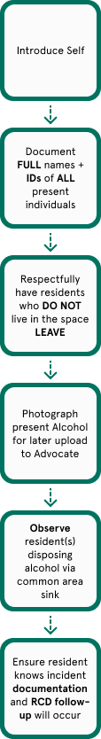

# Alcohol.docx

> Historical source text observed 2026-10-22. Original wording may contain errors or outdated instructions; confirm current policy with Residential Life. Redactions and extraction limits are recorded below.

Source: [authenticated source page](https://gowustl.sharepoint.com/sites/WashUResidentAdvisors/SitePages/Policies-and-Procedures.aspx) — find **Alcohol.docx**.

## Extracted document text

Alcohol

Wednesday, August 28, 2024

2:41 PM

Introduce Self

Document FULL names and IDs of ALL present individuals

Respectfully have residents who DO NOT live in the space LEAVE

Photograph present alcohol for later upload to Advocate

Observe resident(s) disposing alcohol via common area sink

Ensure resident knows incident documentation and RCD follow-up will occur

### Embedded image image1.png

OCR transcription (may contain errors; image layout determines reading order):

Introduce Self Document FULL names 4' IDs of ALL present individuals Respectfully have residents who DO NOT live in the space LEAVE Photograph present Alcohol for later upload to Advocate Observe resident(s) disposing alcohol via common area sink Ensure resident knows incident documentation and RCD follow- up will occur

## Extraction notes

- DOCX body paragraphs, tables, footnotes, and endnotes extracted; headers, footers, comments, revisions, and text in drawings are not guaranteed. Tables use pipes and slash-separated cell paragraphs.
- Source typos and dated policy claims are retained. See SOURCE_NOTES.md before relying on this material.
