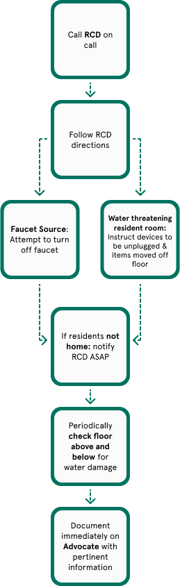

# Flooding.docx

> Historical source text observed 2026-10-22. Original wording may contain errors or outdated instructions; confirm current policy with Residential Life. Redactions and extraction limits are recorded below.

Source: [authenticated source page](https://gowustl.sharepoint.com/sites/WashUResidentAdvisors/SitePages/Policies-and-Procedures.aspx) — find **Flooding.docx**.

## Extracted document text

Flooding

Wednesday, August 28, 2024

2:41 PM

Call the RCD on call

Follow the RCD directions

If a faucet is the source-attempt to turn it off

If water is threatening the resident's room- instruct that devices be unplugged and items moved off the floor

If residents are not home, notify the RCD ASAP

Periodically check the floor above and below for water damage

Document immediately on Advocate with pertinent information

### Embedded image image1.png

OCR transcription (may contain errors; image layout determines reading order):

Faucet Source: Attempt to turn off faucet Call RCD on Follow RCD Water t hr•atening resident room: Instruct devices to be unplugged & items moved off floor If residents not home: notify RCD ASAP Periodically check noor above and below for water damage Document immediately on Advocate with pertinent information

## Extraction notes

- DOCX body paragraphs, tables, footnotes, and endnotes extracted; headers, footers, comments, revisions, and text in drawings are not guaranteed. Tables use pipes and slash-separated cell paragraphs.
- Source typos and dated policy claims are retained. See SOURCE_NOTES.md before relying on this material.
