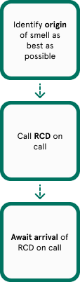

# Marijuana and Other Drugs.docx

> Historical source text observed 2026-10-22. Original wording may contain errors or outdated instructions; confirm current policy with Residential Life. Redactions and extraction limits are recorded below.

Source: [authenticated source page](https://gowustl.sharepoint.com/sites/WashUResidentAdvisors/SitePages/Policies-and-Procedures.aspx) — find **Marijuana and Other Drugs.docx**.

## Extracted document text

Marijuana and Other Drugs

Wednesday, August 28, 2024

2:42 PM

Identify the origin of the smell as best as possible

Call the RCD on call

Await arrival of the RCD on call

*Note- if you cannot pinpoint the origin, please submit an IR indicating the floor/general area of the smell

### Embedded image image1.png

OCR transcription (may contain errors; image layout determines reading order):

Identify origin of smell as best as possible call RCD on Await arrival of RCD on call

## Extraction notes

- DOCX body paragraphs, tables, footnotes, and endnotes extracted; headers, footers, comments, revisions, and text in drawings are not guaranteed. Tables use pipes and slash-separated cell paragraphs.
- Source typos and dated policy claims are retained. See SOURCE_NOTES.md before relying on this material.
