# Roommate Mediation Presentation.docx

> Historical source text observed 2026-10-22. Original wording may contain errors or outdated instructions; confirm current policy with Residential Life. Redactions and extraction limits are recorded below.

Source: [authenticated source page](https://gowustl.sharepoint.com/sites/WashUResidentAdvisors/SitePages/Policies-and-Procedures.aspx) — find **Roommate Mediation Presentation.docx**.

## Extracted document text

Roommate Mediation

Monday, November 18, 2024

6:59 PM

Questions to ask yourself when dealing with roommate conflict: 

Is this situation violent? 

Do any of the students involved feel unsafe? 

Does the situation include Title IX/RSVP issues? 

Is there bullying involved? 

Cyber bullying

Physical or verbal bullying 

Is there a history of conflict in this room/suite/apartment? 

Are any ResLife or university policies being violated? 

If your answer is "yes" or "maybe" to any of the above questions, please file an IR.  

Quick Tips 

When handling a roommate conflict, please keep your RCD or the RCD on call (after business hours) in the loop. They can help you determine when you need to write an IR. 

It is better to over report than under report. If you are unsure about whether or not you need to write an IR, just call up or write the IR. We are never going to be upset about you reporting something. 

Take detailed notes if you are doing a mediation or after having a conversation with a student. Add these notes to your IR. 

Keep screenshots, pictures, etc to add to the IR 

If it feels overwhelming, that is okay! Call up and release the situation to the RCD

### Embedded image image1.png

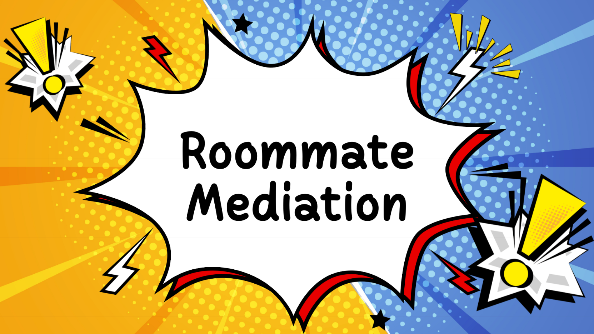

OCR transcription (may contain errors; image layout determines reading order):

Roommate Mediation

### Embedded image image2.png

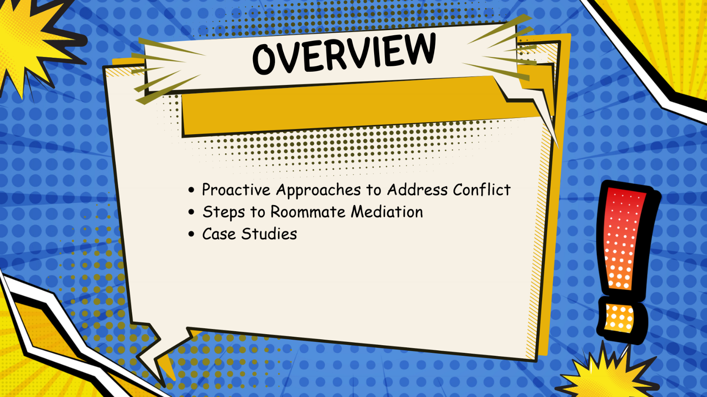

OCR transcription (may contain errors; image layout determines reading order):

D009"e OVERVIEW • Proactive Approaches to Address Conflict • Steps to Roommate Mediation • Case Studies

### Embedded image image3.png

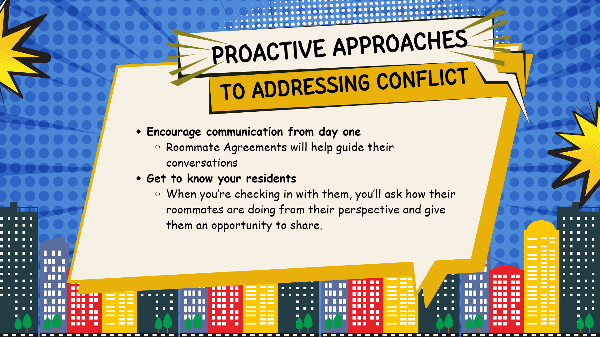

OCR transcription (may contain errors; image layout determines reading order):

'000000 ROACTIVE APPROACHE TO ADDRESSING CONFLICT Encourage communication from day one Roommate Agreements will help guide their o conversations Get to know your residents When you're checking in with them, you'll ask how their o roommates are doing from their perspective and give them an opportunity to share. oc

### Embedded image image4.png

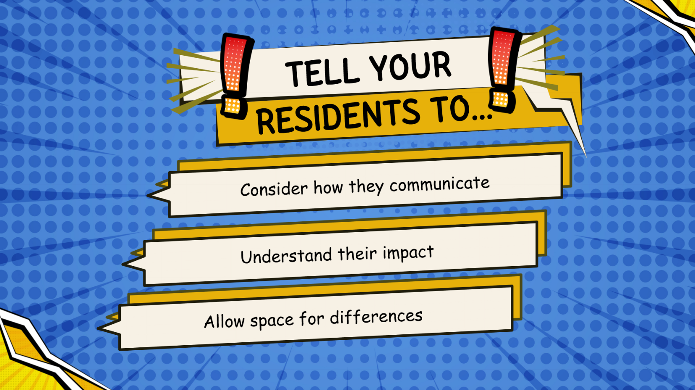

OCR transcription (may contain errors; image layout determines reading order):

'000000 ooeee. '000 0 '0 '000 Deeooeeeo. DOOooeooo DOOOOO TELL YOUR RESIDENTS TO... Consider how they communicate Understand their impact Allow space for differences 00000' SOOOOO' (D e eoooo« e eeeoooo« oooeoooo« ' e e eoeoooo«

### Embedded image image5.png

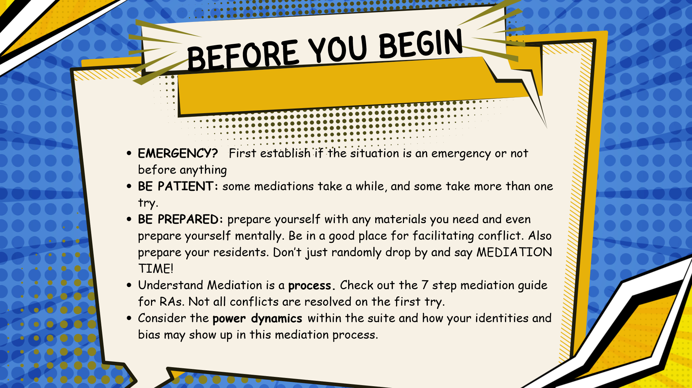

OCR transcription (may contain errors; image layout determines reading order):

E YOU BEGIN • EMERGENCY? First establiShüf•the situation is an emergency or not before anything • BE PATIENT: some mediations take a while, and some take more than one try. • BE PREPARED: prepare yourself with any materials you need and even prepare yourself mentally. Be in a good place for facilitating conflict. Also prepare your residents. Don't just randomly drop by and say MEDIATION TIME! • Understand Mediation is a process. Check out the 7 step mediation guide for RAS. Not all conflicts are resolved on the first try. • Consider the power dynamics within the suite and how your identities and bias may show up in this mediation process. 00000' 00000'

### Embedded image image6.png

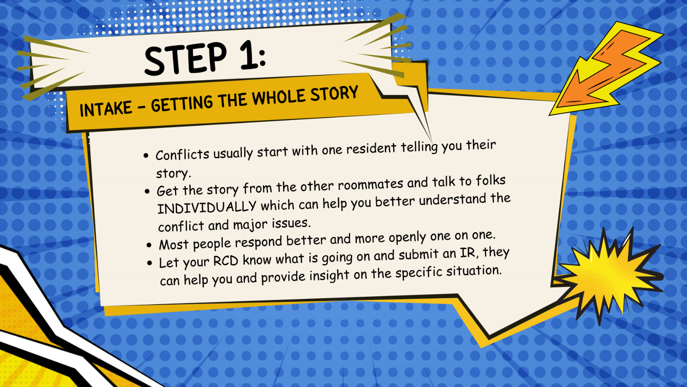

OCR transcription (may contain errors; image layout determines reading order):

SOO Deee INTAKE - STEP 1: GETTING THE WHOLE STORY D0090€ DOOOOC DOoooe ooo • • Conflicts usually start with one resident telling you their story. Get the story from the other roommates and talk to folks INDIVIDUALLY which can help you better understand the conflict and major issues. Most people respond better and more openly one on one. Let your RCD know what is going on and submit an IR, they can help you and provide insight on the specific situation. eeeoooo« i" eoooo«

### Embedded image image7.png

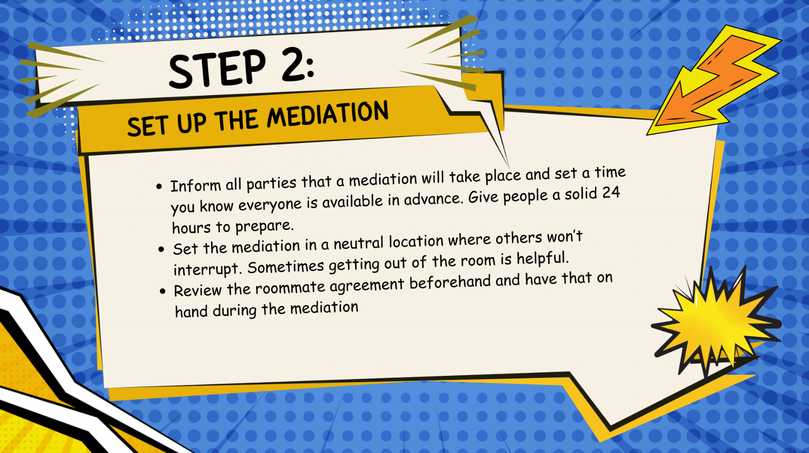

OCR transcription (may contain errors; image layout determines reading order):

Doee. STEP 2: SET UP THE MEDIATION • DOOOO • Inform all parties that a mediation will take place and set a time you know everyone is available in advance. Give people a solid 24 hours to prepare. Set the mediation in a neutral location where others won't interrupt. Sometimes getting out of the room is helpful. Review the roommate agreement beforehand and have that on hand during the mediation

### Embedded image image8.png

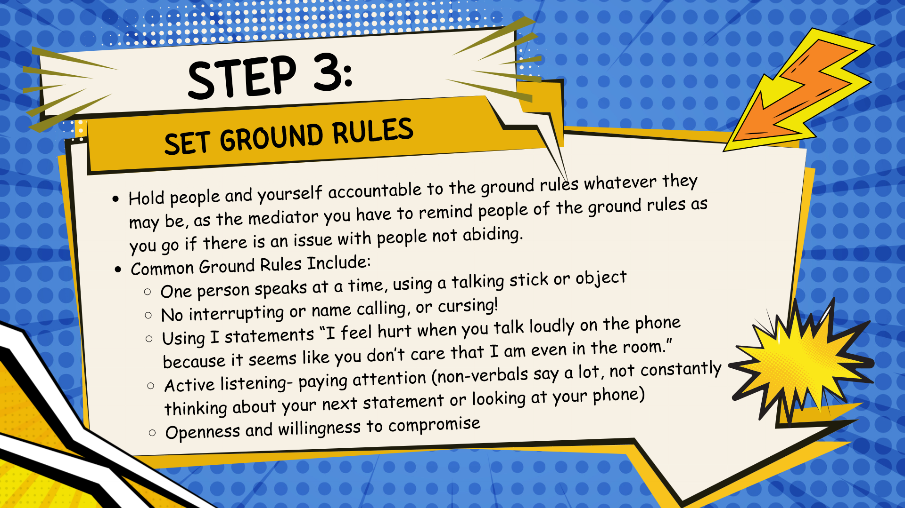

OCR transcription (may contain errors; image layout determines reading order):

STEP 3: SET GROUND RULES • Hold people and yourself accountable to the ground rul s whatever they may be, as the mediator you have to remind people of the ground rules as you go if there is an issue with people not abiding. • Common Ground Rules Include: One person speaks at a time, using a talking stick or object No interrupting or name calling, or cursing! Using I statements "I feel hurt when you talk loudly on the phone because it seems like you don't care that I am even in the room." Active listening- paying attention (non-verbals say a lot, not constantly thinking about your next statement or looking at your phone) Openness and willingness to compromise

### Embedded image image9.png

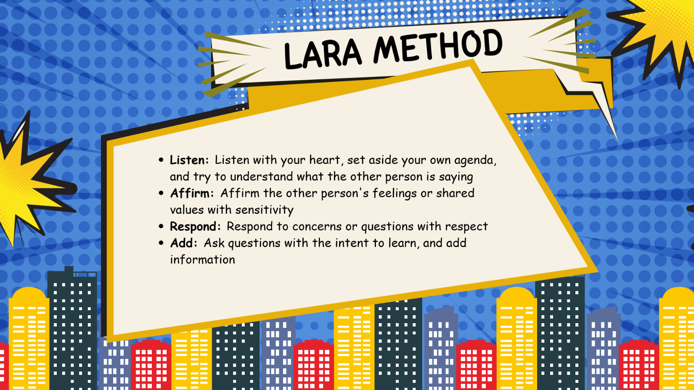

OCR transcription (may contain errors; image layout determines reading order):

LARA METHOD • Listen: Listen with your heart, set aside your own agenda, and try to understand what the other person is saying • Affirm: Affirm the other person's feelings or shared values with sensitivity • Respond: Respond to concerns or questions with respect • Add: Ask questions with the intent to learn, and add information •e e e eoeoo« o '0000' Söoov .oeeoo«

### Embedded image image10.png

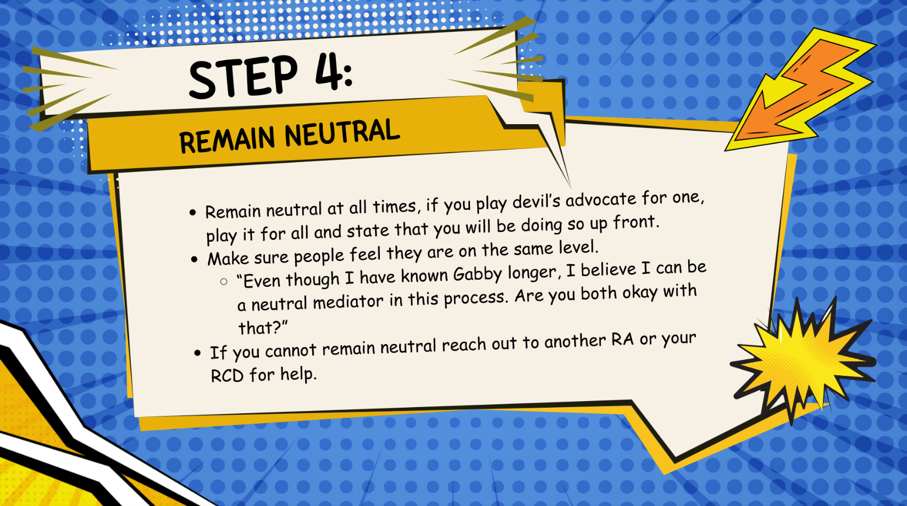

OCR transcription (may contain errors; image layout determines reading order):

sco STEP 4: REMAIN NEUTRAL Doooe« Remain neutral at all times, if you play devil's advocate for one, • Deeoec play it for all and state that you will be doing so up front. Make sure people feel they are on the same level. "Even though I have known Gabby longer, I believe I can be o •ooooo a neutral mediator in this process. Are you both okay with • If you cannot remain neutral reach out to another RA or your ooo RCD for help. - Toc oeoo«

### Embedded image image11.png

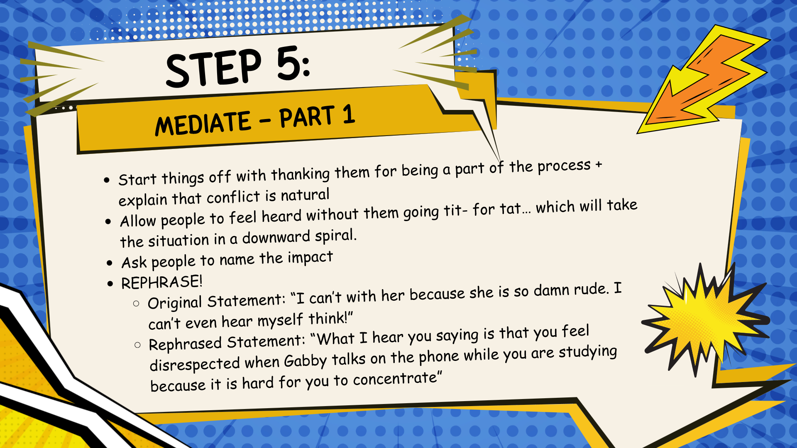

OCR transcription (may contain errors; image layout determines reading order):

soo DO DOA STEP 5: MEDIATE - PART 1 o 9000 Start things off with thanking them for being a part o the process + explain that conflict is natural Allow people to feel heard without them going tit- for tat.. which will take the situation in a downward spiral. Ask people to name the impact • REPHRASE! Original Statement: "I can't with her because she is so damn rude. I can't even hear myself think!" Rephrased Statement: "What I hear you saying is that you feel disrespected when Gabby talks on the phone while you are studying because it is hard for you to concentrate" ooc ooc ooc 4

### Embedded image image12.png

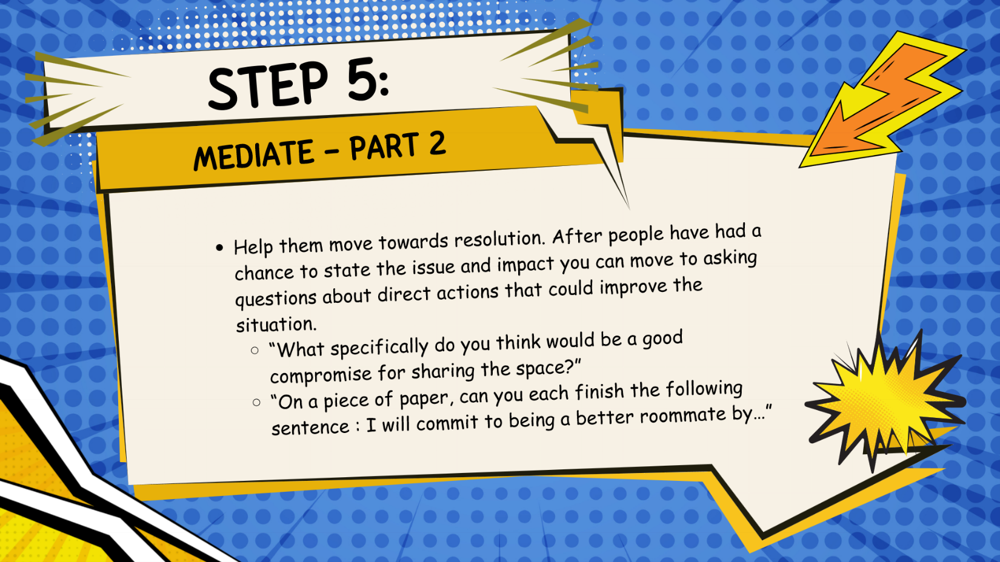

OCR transcription (may contain errors; image layout determines reading order):

•eeoo STEP 5: MEDIATE - PART 2 • Help them move towards resolution. After people have had a chance to state the issue and impact you can move to asking questions about direct actions that could improve the situation. "What specifically do you think would be a good compromise for sharing the space?" "On a piece of paper, can you each finish the following sentence : I will commit to being a better roommate by..

### Embedded image image13.png

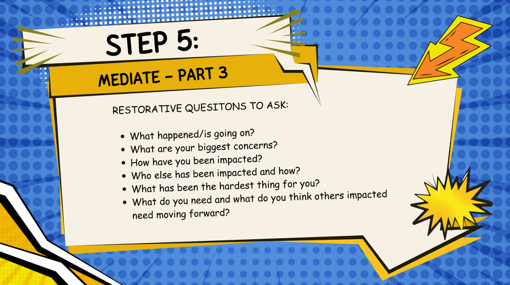

OCR transcription (may contain errors; image layout determines reading order):

sco Deeoo STEP 5: MEDIATE - PART 3 RESTORATIVE QUESITONS TO ASK: • What happened/is going on? • What are your biggest concerns? • How have you been impacted? • Who else has been impacted and how? • What has been the hardest thing for you? • What do you need and what do you think others impacted need moving forward? 000< 990<

### Embedded image image14.png

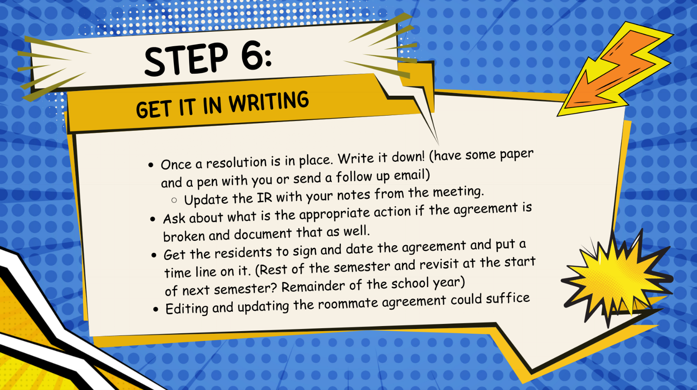

OCR transcription (may contain errors; image layout determines reading order):

STEP 6: GET IT IN WRITING Dooe '0000' • • • Once a resolution is in place. Write it down! (have some paper and a pen with you or send a follow up email) Update the IR with your notes from the meeting. Ask about what is the appropriate action if the agreement is broken and document that as well. Get the residents to sign and date the agreement and put a time line on it. (Rest of the semester and revisit at the start of next semester? Remainder of the school year) Editing and updating the roommate agreement could suffice

### Embedded image image15.png

OCR transcription (may contain errors; image layout determines reading order):

STEP 7: FOLLOW-UP Dooe. DOOOO eeo( • Check up on the residents a week or so after the agreement is made. Update your IR with any additional details and talk with o your RCD. If necessary help the residents recommit themselves to the agreement. Depending on how things go you may have to start the process over again and possibly involve your RCD.

### Embedded image image16.png

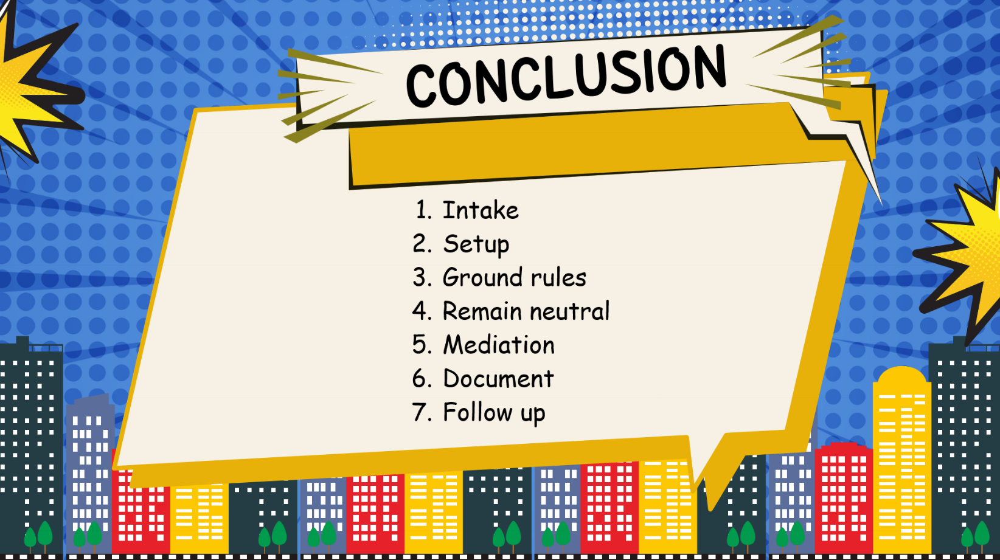

OCR transcription (may contain errors; image layout determines reading order):

CONCLUSION 90000 e DOG09" D e, e OOO 1. 2. 3. 4. 5. 6. 7. Intake Setup Ground rules Remain neutral Mediation Document Follow up • 111

## Extraction notes

- DOCX body paragraphs, tables, footnotes, and endnotes extracted; headers, footers, comments, revisions, and text in drawings are not guaranteed. Tables use pipes and slash-separated cell paragraphs.
- Source typos and dated policy claims are retained. See SOURCE_NOTES.md before relying on this material.
